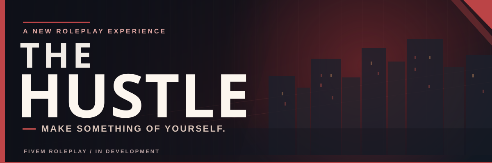

 

**AN INDEPENDENT FIVEM ROLEPLAY EXPERIENCE**

*Build a life. Take a risk. Leave your mark.*

[The Experience](#the-experience) &nbsp;&bull;&nbsp; [Our Focus](#what-were-building) &nbsp;&bull;&nbsp; [**PUBLIC ROADMAP**](https://github.com/TheHustle5M/.github/blob/main/profile/ROADMAP.md) &nbsp;&bull;&nbsp; [FAQ](#frequently-asked-questions)

---

## Welcome to The Hustle

**A good roleplay world doesn't tell you who to be. It gives you reasons to become someone.**

The Hustle is an independent, in-development roleplay project set in the world of **San Andreas**, built on FiveM. Our goal is to create a multiplayer experience where the little things carry weight: the work you put in, the risks you take, the people you know, and the decisions you make along the way.

This isn't about handing every player the same storyline. It's about giving people the freedom to build their own, whether that means putting in an honest day's work, running a business, chasing opportunities on the wrong side of the law, or simply finding a place in the city.

We're building with a particular idea in mind: **a believable world is made from connected, meaningful interactions.**

## The experience

<table>
<tr>
<td width="50%" valign="top">

### LIVE YOUR OWN STORY
Start small and find your footing. Legitimate work, relationships, ambition, and opportunity all have a place in the kind of world we're building. Your character's direction is yours to choose.

</td>
<td width="50%" valign="top">

### RISK HAS A PRICE
The more you're willing to risk, the greater the potential reward and the consequences. Criminal opportunities, contested territory, and reputation are part of our long-term vision.

</td>
</tr>
<tr>
<td valign="top">

### THE DETAILS MATTER
What you carry, where you store it, and how you interact with the world should feel meaningful. We're exploring deeper inventory, item, weapon, and vehicle interactions rather than treating everything like a menu.

</td>
<td valign="top">

### A WORLD THAT RESPONDS
We want an economy and progression system shaped by player activity, not just repetitive tasks. Work, scarcity, relationships, and competing interests should create reasons for players to interact.

</td>
</tr>
</table>

> **The idea:** One player sees a quiet town full of chances to earn a living. Another sees a place full of opportunities to take. Both should have compelling reasons to get out of bed tomorrow.

## What we're building

We're focusing on a few connected areas of gameplay. These are **development priorities and design goals**, not a claim that every feature is already finished or available to play.

| Area | Our direction |
| :--- | :--- |
| **Everyday life** | Useful jobs, earning a living, ownership, and room for player-created stories. |
| **Crime & opportunity** | Robberies, underground activity, reputation, and choices with meaningful trade-offs. |
| **Items & equipment** | More physical inventory interactions, equipment management, and items that have a presence in the world. |
| **Vehicles & storage** | Vehicles as more than transportation, with storage and interactions that make practical sense. |
| **Economy & progression** | Multiple paths to progress, longer-term goals, and systems designed to work together. |
| **Social roleplay** | Player interactions, collaboration, conflict, and the unexpected moments that make multiplayer worlds memorable. |

### The world should reward curiosity

We don't want every interaction reduced to pressing a button, collecting a paycheck, and repeating it forever. Our goal is a world where preparation matters, experimentation feels worthwhile, and seemingly small decisions can lead somewhere interesting.

The most memorable roleplay rarely follows a script. **We're designing the space for those moments to happen.**

---

## Development journey

**[Explore the public development roadmap →](https://github.com/TheHustle5M/.github/blob/main/profile/ROADMAP.md)**

Our public roadmap is based on the real milestones and gameplay workstreams tracked in private development. It covers what's planned, what's being tested, and where we're headed without exposing internal repositories.

**FOUNDATION** &nbsp; ➜ &nbsp; **ALPHA** &nbsp; ➜ &nbsp; **BETA** &nbsp; ➜ &nbsp; **LAUNCH**

| Stage | What it means |
| :--- | :--- |
| **01 / Foundation — Current focus** | Establishing core gameplay foundations, prototyping interactions, and connecting the essential systems. |
| **02 / Alpha — Nov 30, 2026 target** | Early hands-on testing of the core player experience, reliability, and gameplay loops. |
| **03 / Beta — Jan 30, 2027 target** | Broader testing, balance improvements, refinements, and feedback-driven iteration. |
| **04 / Launch — May 30, 2027 target** | Opening access when the experience is ready for people to make it their own. |

**These are internal target dates, not announced public release dates.** Each milestone is subject to testing, scope, and readiness. The [detailed public roadmap](https://github.com/TheHustle5M/.github/blob/main/profile/ROADMAP.md) tracks our current priorities.

### How we're approaching development

- **Gameplay first.** Features should give players something interesting to *do*, not just something impressive to read about.
- **Depth over clutter.** A smaller number of connected, polished systems beats a giant list of disconnected features.
- **Performance matters.** Immersion falls apart when the game doesn't run well.
- **Room to evolve.** Player feedback and testing should shape what survives, changes, or gets cut.

---

## Frequently asked questions

<b>Can I play The Hustle right now?</b>

 
The project is in development. Public server access has not been announced. When there is an official testing or launch opportunity, details will be shared through public project channels.

<b>What kind of roleplay is it?</b>

 
We're aiming for an immersive, player-driven world that supports both everyday life and higher-risk pursuits. You should have room to pursue your own goals without being forced into a single playstyle.

<b>Is everything described here already implemented?</b>

 
No. This page explains the direction of the project. Features and scope may change as development and testing continue.

<b>When are applications, Discord, or early access opening?</b>

 
No dates or community invitations are being advertised here yet. Official links and announcements will be added when they're ready.

<b>Is the project open source?</b>

 
The Hustle is being developed as a private project. This organization profile is for sharing the vision and public updates, not distributing the server's source code.

---

### THE CITY ISN'T GOING ANYWHERE.

**We're taking the time to make it worth showing up for.**

Follow the public updates on this page as The Hustle develops.

 

THE HUSTLE · INDEPENDENT FIVEM ROLEPLAY PROJECT

Not affiliated with or endorsed by Rockstar Games, Take-Two Interactive, or Cfx.re.

