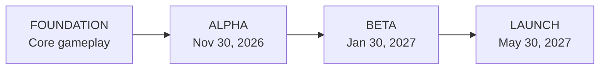

# THE HUSTLE / ROADMAP

**From the first playable build to a living San Andreas.**

[← Back to The Hustle](https://github.com/TheHustle5M)

---

> **What this is:** A public summary of active planning and development drawn from The Hustle's private issue tracker and development milestones. It's a window into the work, **not a public view of the private repositories**. Features and dates may change as testing progresses.

## The road to launch

| Milestone | Target | Where we're heading | Status |
| :--- | :--- | :--- | :--- |
| **Foundation** | Now | Connect the essentials: characters, inventory, interactions, economy, and a playable activity loop. | **In development** |
| **Alpha** | **Nov 30, 2026** | First internally playable build, with basic progression and shared-world testing. | **Planned** |
| **Beta** | **Jan 30, 2027** | Expand gameplay, test with more players, tune progression, and improve reliability. | **Planned** |
| **Launch** | **May 30, 2027** | Public-ready core experience, stable systems, onboarding, and ongoing updates. | **Target** |

**Dates are internal targets, not promises of public access.** Alpha is intended for internal testing; a public Beta invitation has not been announced. Launch depends on gameplay quality, testing, and server readiness.

---

## Gameplay systems

These are real workstreams being designed, developed, or validated. Statuses reflect the latest available development notes, **not** a claim that the features are already playable on a public server.

| Feature | Player experience | Status |
| :--- | :--- | :--- |
| **Physical inventory & storage** | A deeper way to manage equipment, containers, and the space your items occupy. | **In development / testing** |
| **Visible vehicle cargo** | Store items in vehicles and see a consistent shared representation of what is inside. | **Multiplayer validation** |
| **Item throwing & world drops** | Move, drop, throw, and recover physical items in the game world. | **Prototype testing** |
| **Weapon equipment & ammunition** | Handle magazines, unpack ammunition boxes, and prepare before a firefight. | **Design / planned** |
| **Inventory item visuals** | Clearer, context-aware equipment imagery, including weapon attachments and appearance. | **Integration testing** |
| **Banking & finances** | Multiple banking experiences, personal finances, and room for more involved financial roleplay. | **Planning** |
| **Shops & vendors** | More natural shopping and trading interactions within the world. | **Planning** |
| **World interactions** | Consistent, context-aware interactions with people, objects, and places. | **Planning** |
| **Reputation & territory** | Build a name, compete for influence, and give local conflict greater meaning. | **Planning** |

### What's receiving attention now

**Inventory and physical interactions** are among the most actively documented systems. Recent work covers multiplayer vehicle storage, item handling, and more detailed equipment visuals. That work is still subject to real-game validation and release testing.

**Weapon and ammunition depth** is a newer planned gameplay system: finding sealed ammunition, unpacking rounds, loading individual magazines, and choosing what to carry rather than magically reloading from an ammo counter.

**The wider economy** is being scoped around practical server gameplay first. Banking, shops, and reputation should support meaningful choices without holding up the first playable build.

---

## What each status means

| Status | Meaning |
| :--- | :--- |
| **Planning** | The gameplay direction is being defined. It isn't an implementation promise. |
| **Design / planned** | A feature has a more detailed design or development issue, but isn't release-ready. |
| **In development** | Active implementation or integration work exists. |
| **Prototype testing** | An early implementation has been exercised; real-world edge cases may remain. |
| **Multiplayer / integration testing** | Work exists, but multiplayer or end-to-end acceptance is still in progress. |
| **Released** | Available in an announced build. Nothing is marked released merely because an internal issue was closed. |

## How we'll decide what's ready

Our goal is not to tick off a massive feature list and call it a launch. The important checks are simple:

- The core actions work consistently for more than one player.
- Inventory, equipment, and progression survive normal gameplay and reconnects.
- The economy and activities create reasons to play beyond the first hour.
- The game remains stable enough to support sustained sessions.
- The experience makes sense to somebody who wasn't involved in building it.

A feature can be developed without being **approved for release**. Public status will reflect that distinction.

---

## Keep an eye on the city

This page will be updated as meaningful milestones are reached. Dates, scope, and ordering may change as development progresses.

**Roadmap snapshot:** October 30, 2026. This page is currently a curated public snapshot, not an automatically synchronized live issue feed.

**THE HUSTLE**

*Make something of yourself.*

[Return to the homepage](https://github.com/TheHustle5M)

